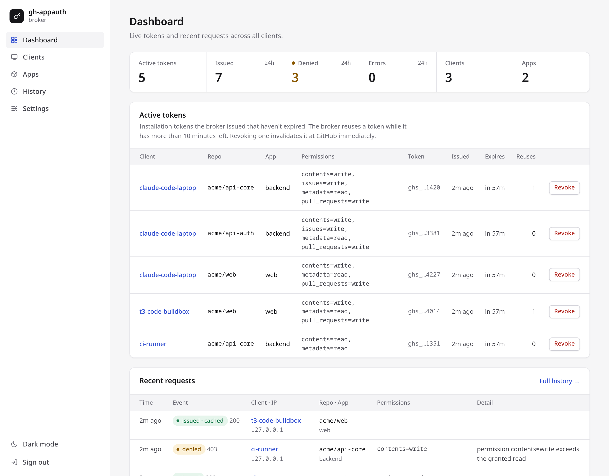
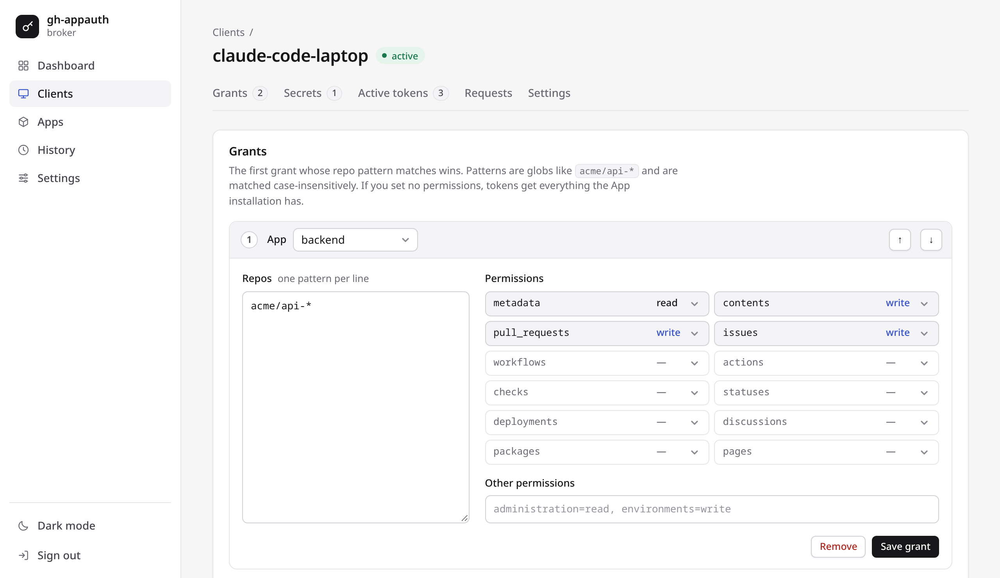
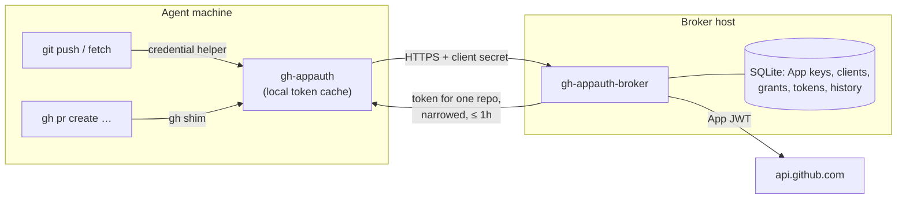

# gh-appauth

gh-appauth lets coding agents like Claude Code and Codex work on GitHub as a GitHub App, without the App's private key ever touching the agent's machine.

You run a small broker on a host you trust, and it keeps the App keys. Each agent machine gets its own client secret plus a `gh` extension that plugs into `git` and `gh`. When the agent runs `git push` or `gh pr create`, the extension asks the broker for a token for that one repository. The broker checks what you've allowed that client to do, gets an installation token from GitHub, narrows it to that repo and those permissions, and hands it back. The token is valid for at most an hour.

## Why not just log the agent in?

The quick ways to give an agent GitHub access are `gh auth login` or a personal access token. Both make the agent act as you, with a credential that stays valid until you revoke it. You could create a separate GitHub account for the agent instead, but in an organization that account takes up a paid seat, and it's one more account to manage.

A GitHub App fits better. It doesn't use a seat, commits and pull requests show up under the App's bot account, and the App's permissions are limited to what you picked when you created it. To use an App directly, though, the agent needs the App's private key, and anyone holding that key can mint a token for every repo the App is installed on with every permission it has. Copying it to several machines spreads that risk around.

With gh-appauth the key stays on the broker. An agent only holds a client secret, and that secret only gets tokens for the repos and permissions you granted it.

So if your agent goes haywire, it can't open issues or comment under your name, and it can't touch repos you didn't grant it. GitHub enforces this: each token works for one repo and never acts as you.

## What it does

- Agents keep using plain `git` and `gh`. `git clone`, `git push` and `gh pr create` work unchanged, and `gh appauth identity` makes commits show up as the App's bot.
- Each client has an ordered list of grants. A grant matches repos by glob (`acme/api-*`), picks an App, and caps the permissions. The first matching grant wins.
- Every token covers a single repo and expires within an hour.
- Revocation happens in one place. Disabling a client, narrowing a grant or replacing an App revokes the affected live tokens at GitHub right away.
- Every request is logged, including the ones the broker refused and why. You get JSON lines on stdout and a request history in the admin UI.
- You can restrict a client to source IPs or CIDRs, so a copied secret is useless from anywhere else.
- One broker can serve several Apps, for example one installed on your backend repos and another on the website.

## Screenshots

The dashboard lists the tokens that are live right now, each with a Revoke button, and the latest requests. The second request below was refused because the `ci-runner` client asked for write access and its grant only allows read.



On a client's page you set its grants. This one gives the `claude-code-laptop` client write access to code, pull requests and issues in every `acme/api-*` repo, through the App named `backend`.



On the agent machine, `gh appauth status` shows what the client can reach and which token the current repo would get:

```
$ gh appauth status
...
Client:  claude-code-laptop (seen from 127.0.0.1)
Grants:
  backend → acme/api-* (contents=write,issues=write,metadata=read,pull_requests=write)
  web → acme/web, acme/docs (contents=write,metadata=read,pull_requests=write)
Repo:    acme/api-core
  app:         backend
  bot:         acme-backend-agent[bot] <555+acme-backend-agent[bot]@users.noreply.github.com>
  expires:     20:13:09 (57m0s)
  permissions: contents=write,issues=write,metadata=read,pull_requests=write
  source:      broker

$ gh appauth token acme/secrets
gh-appauth: denied for acme/secrets: client "claude-code-laptop" has no grant for acme/secrets
```

## How it works



The repo builds two programs:

| Binary | What it is |
|---|---|
| `gh-appauth-broker` | A small HTTP service with an admin web UI. It keeps the App keys in SQLite and issues short-lived installation tokens, each limited to one repo. Its only third-party dependency is a pure-Go SQLite. |
| `gh-appauth` | A `gh` CLI extension (`gh appauth …`) that sets up `git` as a credential helper and wraps `gh` so both fetch tokens from the broker. It uses the Go standard library only. |

On the agent side, `git` calls the extension as a credential helper, and an optional `gh` wrapper (the shim) works out which repo a command is for and sets `GH_TOKEN`. The extension caches tokens locally and reuses them while they have more than 10 minutes left, so most commands don't reach the broker at all.

## Getting started

Follow [docs/setup.md](docs/setup.md). You install the broker on a host you control, create a GitHub App, add the App and your clients in the admin UI, and then install the `gh` extension on each agent machine.

## Documentation

- [Setup](docs/setup.md): installing the broker, creating the GitHub App, configuring clients and agent machines
- [Security model](docs/security.md): what the broker protects against and what it doesn't
- [Broker reference](docs/broker.md): command-line flags, TLS modes, the admin UI and the HTTP API
- [Extension reference](docs/extension.md): `gh appauth` commands, environment variables, the token cache and known gaps
- [Operations](docs/operations.md): rotating secrets and keys, revoking access, backups, running behind a reverse proxy
- [Development](docs/development.md): tests and code layout
